# 🚀 Awesome Data Application Frameworks

  

  
  
  
  
  
  

---

## 🌟 Introduction & Ecosystem Overview

Welcome to the definitive, community-curated directory of **Data Application Frameworks**, **Python-native dashboards**, **reactive web UI libraries**, and **notebook-to-app conversion platforms**. 

Whether you are a data scientist transforming Jupyter notebooks into shareable prototypes, an analytics engineer shipping production-grade business intelligence portals, or an AI developer exposing machine learning models via interactive interfaces and MCP (Model Context Protocol) endpoints, this guide covers the entire landscape of hosted SaaS services and open-source developer tooling.

---

## 📑 Table of Contents

- [🌐 Sector Overview & Market Dynamics](#-sector-overview--market-dynamics)
- [☁️ Hosted & SaaS Data Application Platforms](#️-hosted--saas-data-application-platforms)
- [💻 Open-Source Data Application Frameworks](#-open-source-data-application-frameworks)
- [🧭 Architectural Decision Matrix: Which Tool to Choose?](#-architectural-decision-matrix-which-tool-to-choose)
- [🤝 How to Contribute](#-how-to-contribute)
- [⭐ Star History](#star-history)
- [💖 Support](#-support)
- [📜 License & Community Guidelines](#-license--community-guidelines)

---

## 🌐 Sector Overview & Market Dynamics

The global Business Intelligence (BI) and Data Analytics Software sector is estimated at **$43.7B to $52.8B in 2026** (with the broader data application development software market exceeding **$314B**). 

The sector exhibits **moderate fragmentation across developer layers with a bifurcated concentration model**: while cloud infrastructure hyperscalers and data warehouses (Snowflake, Databricks, Microsoft Azure) consolidate backend compute and storage runtimes, the front-end data application presentation layer remains highly open, diversified, and competitive between pure-Python reactive frameworks, AI-native demo interfaces, and internal drag-and-drop tool builders rather than a single winner-take-all monopoly.

---

## ☁️ Hosted & SaaS Data Application Platforms

The following table benchmarks managed cloud deployment platforms, visual builder platforms, and hosted runtimes tailored for data applications and analytics dashboards. Entries are **sorted descending by company size (valuation or annual revenue)**.

| 🏢 Platform / Product | 📈 Company Size (Valuation / Revenue) | 💵 Starting Tier Pricing | 🎁 Free Tier / Trial Limits | 🎯 Key Capabilities & Best For |
| :--- | :--- | :--- | :--- | :--- |
| **[Streamlit Community Cloud](https://streamlit.io/cloud)** (Snowflake) | **~$55B Valuation / Market Cap** (~$3.6B Annual Revenue) | **$0 / month** (Community Cloud) / **$2.00 per compute credit** for private apps via Snowflake Standard Edition | **Free forever plan**: Up to 3 active public apps per GitHub account, 1 GB RAM, 1 CPU per container, 1 shared resource pool; apps automatically hibernate after 7 consecutive days of inactivity and wake on HTTP access | Zero-configuration GitHub repo deployments, instant sharing of public Python data apps, and seamless enterprise transitions via Snowflake Native Apps. |
| **[Hugging Face Spaces](https://huggingface.co/spaces)** (Hugging Face) | **$4.5B Valuation** (Series D) / ~$100M ARR | **$9.00 / month** (PRO Account) or on-demand compute starting at **$0.03 / hour** (CPU Upgraded) / **$0.40 / hour** (Nvidia T4 GPU) | **Free forever plan**: Unlimited public Spaces on CPU Basic hardware (2 vCPU, 16 GB RAM, 50 GB non-persistent disk) and queued community ZeroGPU quota | AI/ML demonstrations, Gradio and Streamlit app deployments, instant Model Context Protocol (MCP) tool exposure, and community model benchmarking. |
| **[Retool](https://retool.com)** (Retool, Inc.) | **$3.2B Valuation** (Series C) / ~$100M ARR | **$10.00 / builder / month** (billed annually at $120/yr) or $12.00 billed monthly + $5.00/internal user/month (Team plan) | **Free forever plan**: Up to 5 total users (builders + end-users), unlimited web & mobile apps, 500 workflow runs/month, 5 GB Retool Database (PostgreSQL), 5 GB storage, and 250 AI credits/month | Low-code drag-and-drop UI component assembly, internal operations tooling, CRUD database administration, and rapid connection to 50+ REST/GraphQL/SQL backends. |
| **[Anaconda Cloud / Notebooks](https://www.anaconda.com/products/notebooks)** (Anaconda Inc.) | **~$1.5B Valuation** (Series B) / ~$100M ARR | **$9.00 / month** (billed annually at $99.00/yr) for Anaconda Starter tier | **Free forever plan**: 1 published interactive web application (HoloViz Panel), 5 GB persistent cloud storage, 1 vCPU and 4 GB RAM interactive Jupyter notebook environment | PyData-centric teams developing complex scientific visualizations, HoloViz Panel deployment, and curated conda package dependencies without local environment overhead. |
| **[Hex](https://hex.tech)** (Hex Technologies, Inc.) | **~$500M+ Valuation** (Series B) / ~$25M+ ARR | **$36.00 / editor / month** (billed annually at $432/yr) or $45.00 billed monthly (Professional plan) | **Free forever plan** (Community Plan): Up to 3 project authors, 5 published interactive data apps/projects, shared compute profile (0.5 vCPU, 4 GB RAM), 7-day version history, 100 AI actions/month | Collaborative SQL + Python analytics notebooks, seamless notebook-to-app conversion, automatic caching, and interactive exploration for data science teams. |
| **[Posit Connect Cloud](https://posit.cloud)** (Posit PBC / formerly RStudio) | **~$500M Est. Valuation** (Public Benefit Corp) / ~$100M ARR | **$19.00 / month** (Basic tier: 8 GB RAM, 2 CPU, up to 25 deployed applications) | **Free forever plan**: Up to 3 published projects/applications, 1 GB RAM, 1 shared CPU core, 5 concurrent user connections, and community forum support | Publishing and sharing Shiny for Python, Shiny for R, Quarto documents, and Streamlit dashboards with environment reproduction and automated package management. |
| **[Metabase Cloud](https://www.metabase.com/pricing)** (Metabase, Inc.) | **~$200M Valuation** (Series B) / ~$20M ARR | **$100.00 / month** ($90.00 / month billed annually; includes 5 users, then $6.00 / user / month) | **14-day free trial** of Cloud Starter or Cloud Pro (full feature access, automated cloud hosting, backups, 5 users; credit card verification required, cancel anytime); permanent free self-hosted open-source version available | Self-service BI dashboards, visual SQL query builders for non-technical teammates, automated scheduled Slack/email report alerts, and embedded client-facing charts. |
| **[Preset Cloud](https://preset.io/pricing)** (Preset Inc.) | **~$150M Valuation** (Series B) / ~$15M ARR | **$20.00 / user / month** (billed annually at $240/yr) or $25.00 billed monthly (Professional plan) | **Free forever plan** (Starter Plan): Up to 5 users (all Team Admins), 1 workspace, unlimited charts & dashboards, 40+ visualization types; workspaces automatically hibernate after 30 days of inactivity | Hosted and enterprise-hardened Apache Superset BI, collaborative SQL Lab, granular role-based access control, and enterprise data warehouse exploration. |
| **[Plotly Cloud / Dash Enterprise](https://plotly.com/dash)** (Plotly Technologies) | **~$150M Est. Valuation** / ~$30M ARR | **$29.00 / creator / month** (billed annually at $290.00/yr) for Plotly Cloud Pro | **Free trial plan**: 10 Plotly compute credits trial, 1 Creator seat, 3 private viewers, and 1 published Dash or Plotly Studio analytical application | High-performance interactive analytical web apps, complete control over fine-grained reactive callback graphs, and complex charting for enterprise analytics teams. |
| **[Anvil](https://anvil.works/pricing)** (The Anvil Works Ltd.) | **~$10M Est. Valuation** (Seed stage) / ~$2M ARR | **$14.00 / month** (billed annually at $168.00/yr) or $15.00 billed monthly (Personal plan) | **Free forever plan**: Unlimited low-throughput applications with Anvil branding banner, shared cloud hosting runtime, built-in database (up to 50,000 table rows), no custom domains | Full-stack web application development exclusively in Python (browser client code runs via Skulpt, backend code runs on server, built-in database & user auth). |

---

## 💻 Open-Source Data Application Frameworks

Below is the curated collection of leading open-source frameworks for developing interactive data applications, dashboards, reactive web interfaces, and BI platforms. 

All repositories are **sorted descending by current GitHub star counts**, featuring a live social star badge linking straight to each repository's stargazers community.

---

### 1. 📊 [Apache Superset](https://github.com/apache/superset) 
- **License**: Apache-2.0  
- **Architecture**: Modern enterprise Business Intelligence web platform written in Python (Flask) and TypeScript/React.
- **Highlights**: Features a rich SQL IDE (SQL Lab), 40+ built-in visualization templates, semantic data modeling, granular role-based security (RBAC), and support for virtually every SQL-speaking database via SQLAlchemy.
- **Best For**: Enterprise-wide business intelligence, exploratory data analysis, and scalable operational dashboards.

---

### 2. 📈 [Metabase](https://github.com/metabase/metabase) 
- **License**: AGPL-3.0 / Commercial  
- **Architecture**: Self-hosted visual business analytics and BI platform written in Clojure and TypeScript/React.
- **Highlights**: Extremely intuitive visual query builder enabling non-technical stakeholders to construct complex aggregations and filters without writing SQL; instant dashboard creation, automatic drilling, and embedded analytics.
- **Best For**: Fast, company-wide self-service business intelligence where usability and simplicity are paramount.

---

### 3. ⚡ [Streamlit](https://github.com/streamlit/streamlit) 
- **License**: Apache-2.0  
- **Architecture**: Script-based Python data application framework that converts flat procedural Python code into interactive web apps.
- **Highlights**: Incredibly fast development cycle with zero HTML/CSS/JS knowledge required. Reruns the script sequentially on user interaction, augmented by `@st.cache_data`, `@st.cache_resource`, and `@st.fragment` for high-performance localized updates.
- **Best For**: Rapid prototyping, internal diagnostic utilities, data science presentations, and single-author tools.

---

### 4. 🤖 [Gradio](https://github.com/gradio-app/gradio) 
- **License**: Apache-2.0  
- **Architecture**: Python library designed for building interactive user interfaces and web demos for machine learning models and LLM agents.
- **Highlights**: First-class support for audio, video, multimodal chat interfaces, and image inputs; native integration with Hugging Face Spaces and automatic Model Context Protocol (MCP) endpoint generation.
- **Best For**: Machine learning model demos, interactive AI playgrounds, multimodal conversational agents, and rapid API testing.

---

### 5. ⚛️ [Reflex](https://github.com/reflex-dev/reflex) 
- **License**: Apache-2.0  
- **Architecture**: Full-stack web framework allowing developers to build reactive frontend applications and backend services in 100% pure Python.
- **Highlights**: Compiles Python UI definitions into a production Next.js / React frontend connected via WebSockets to a FastAPI backend. Provides complete access to the full CSS/Tailwind ecosystem and React component library without writing JavaScript.
- **Best For**: Full-stack applications requiring customizable production UI, multi-page routing, authentication, and state management in pure Python.

---

### 6. 📉 [Dash](https://github.com/plotly/dash) 
- **License**: MIT  
- **Architecture**: Enterprise-grade analytical web application library built on top of Plotly.js, React, and Flask.
- **Highlights**: Explicit callback architecture provides granular control over component updates and state propagation; background callbacks manage long-running distributed compute jobs, and partial property updates patch only modified DOM elements.
- **Best For**: Production data applications requiring tight state control, enterprise styling, and complex interactive chart cross-filtering.

---

### 7. 🍃 [marimo](https://github.com/marimo-team/marimo) 
- **License**: Apache-2.0  
- **Architecture**: Reactive, reproducible Python notebook environment that also serves as a standalone data application server.
- **Highlights**: Notebook cells are organized as a directed acyclic graph (DAG) of pure functions; modifying a cell or interactive UI slider automatically triggers downstream execution without hidden notebook state. Stored as pure, version-control-friendly `.py` files.
- **Best For**: Reactive notebooks, reproducible scientific computing, and interactive data apps converted directly from computational analysis.

---

### 8. 🔄 [Taipy](https://github.com/Avaiga/taipy) 
- **License**: Apache-2.0  
- **Architecture**: Full-stack Python framework specifically engineered for building production-ready data applications and what-if scenario management systems.
- **Highlights**: Distinct separation between reactive graphical user interfaces (Taipy GUI) and backend pipeline orchestration (Taipy Core), with built-in support for data caching, scenario comparison, and scheduling.
- **Best For**: Enterprise decision-support systems, operational planning, scenario exploration, and multi-user data pipelines.

---

### 9. 🎛️ [NiceGUI](https://github.com/zauberzeug/nicegui) 
- **License**: MIT  
- **Architecture**: Lightweight, web-based user interface toolkit for Python powered by FastAPI, Vue.js, and Quasar.
- **Highlights**: Smooth handling of WebSockets, real-time UI updates, interactive charts (Highcharts, ECharts, Plotly), and native 3D scene rendering via Three.js.
- **Best For**: Micro-web applications, connected IoT/robotics dashboards, home automation panels, and lightweight internal tools.

---

### 10. 📝 [Evidence](https://github.com/evidence-dev/evidence) 
- **License**: MIT  
- **Architecture**: Code-based Business Intelligence platform that compiles Markdown and SQL into fast, static, and interactive data websites.
- **Highlights**: Implements the "BI-as-code" paradigm; queries run during static site generation or against fast in-process engines (DuckDB), rendering fast charts and narrative reports with Git version control.
- **Best For**: Data teams seeking reproducible, version-controlled analytics reports and fast static BI websites.

---

### 11. 📓 [Voila](https://github.com/voila-dashboards/voila) 
- **License**: BSD-3-Clause  
- **Architecture**: Turnkey web application renderer that transforms existing Jupyter notebooks into standalone, secure web applications.
- **Highlights**: Suppresses raw code cells and tracebacks while executing notebook kernels server-side and retaining full interactive `ipywidgets` functionality.
- **Best For**: Teams already invested in Jupyter notebook workflows who need to share interactive dashboards without rewriting code into dedicated web frameworks.

---

### 12. 🧩 [Panel (HoloViz)](https://github.com/holoviz/panel) 
- **License**: BSD-3-Clause  
- **Architecture**: High-level data exploration and web application framework from the HoloViz PyData ecosystem.
- **Highlights**: Compatible with Bokeh, Matplotlib, Plotly, Altair, and Vega. Incorporates Datashader integration to render billions of data points server-side without overwhelming web browsers.
- **Best For**: Big data visualization, PyData scientific computing, geospatial mapping, and high-volume sensor telemetry.

---

### 13. ⌨️ [PyWebIO](https://github.com/pywebio/PyWebIO) 
- **License**: MIT  
- **Architecture**: Imperative, script-style Python web application framework that treats web browsers like interactive command-line terminals.
- **Highlights**: Uses synchronous and asynchronous blocking input/output functions (`input()`, `put_text()`) to construct web applications sequentially without requiring GUI event loops or frontend code.
- **Best For**: Command-line developers building quick browser-based input forms, survey collection tools, and linear computational scripts.

---

### 14. 🦆 [Rill](https://github.com/rilldata/rill) 
- **License**: Apache-2.0  
- **Architecture**: Embedded, ultra-fast operational BI and dashboard engine combining DuckDB and Apache Arrow with an interactive web UI.
- **Highlights**: Sub-second dashboard interactions over local files (Parquet, CSV) and cloud data lakes (S3, GCS) without setting up heavy warehouse pipelines.
- **Best For**: Fast exploratory metrics analysis, operational telemetry, and sub-second BI over columnar files.

---

### 15. ☀️ [Solara](https://github.com/widgetti/solara) 
- **License**: Apache-2.0  
- **Architecture**: Pure Python, React-style component framework built on top of `ipywidgets`.
- **Highlights**: Declarative component structure modeled after React hooks (`use_state`, `use_effect`), enabling scalable state management, reusable UI libraries, and high component density.
- **Best For**: Complex, modular web applications and data dashboards requiring formal component hierarchies without JavaScript.

---

### 16. 💡 [Shiny for Python](https://github.com/posit-dev/py-shiny) 
- **License**: MIT  
- **Architecture**: Python implementation of Posit's renowned reactive web application model.
- **Highlights**: Explicit reactive dependency graphs ensure that when an input changes, only the precise subset of calculations and UI elements that depend on that input are recomputed. Includes client-side Pyodide execution (Shinylive) to run full apps in the browser with no backend server.
- **Best For**: Reactive stateful applications, scientific data analysis, and serverless client-side web apps.

---

### 17. 🛠️ [Anvil App Server](https://github.com/anvil-works/anvil-runtime) 
- **License**: AGPL-3.0  
- **Architecture**: Open-source standalone app server that executes Anvil applications in self-hosted enterprise infrastructure.
- **Highlights**: Runs client-side Python in the web browser, connects directly to Python backend services, and automates database integration and session handling.
- **Best For**: Organizations deploying self-hosted full-stack Python business applications without cloud vendor lock-in.

---

### 18. 🌊 [Deephaven Core](https://github.com/deephaven/deephaven-core) 
- **License**: Apache-2.0  
- **Architecture**: Real-time analytical engine and UI framework engineered for streaming time-series data and event-driven data apps.
- **Highlights**: Merges historical batches and real-time live data streams seamlessly; tables auto-update reactively as new events enter the engine without full page refreshes.
- **Best For**: Real-time financial trading dashboards, IoT telemetry feeds, and streaming operational analytics.

---

## 🧭 Architectural Decision Matrix: Which Tool to Choose?

Choosing the right data application framework depends on your target users, state complexity, and latency requirements:

| Use Case / Requirement | Recommended Tool(s) | Primary Rationale |
| :--- | :--- | :--- |
| **Rapid Prototype (< 1 day)** | **Streamlit** / **Gradio** | Fastest development time; intuitive linear script execution. |
| **Interactive ML / LLM Playground** | **Gradio** | Native support for chat streaming, media inputs, ZeroGPU, and MCP agents. |
| **Production Enterprise BI** | **Apache Superset** / **Metabase** | Mature SQL editors, user permission hierarchies, and multi-tenant DB connectors. |
| **Explicit State & Complex Callbacks** | **Dash** / **Shiny for Python** | Granular callback graphs prevent unnecessary full-page recalculations. |
| **Big Data (> 10M rows) / Geospatial** | **Panel (HoloViz)** | Integrated Datashader delivers server-side rasterization without browser crashes. |
| **Real-Time Streaming / Event Data** | **Deephaven Core** | Built-in reactive engine handles high-frequency live time-series streams natively. |
| **Reactive Reproducible Notebooks** | **marimo** | Pure Python files, DAG cell dependencies, and zero hidden notebook state. |
| **Internal Tools & DB Admin Portals** | **Retool** | Drag-and-drop UI component library with out-of-the-box CRUD database integrations. |
| **Version-Controlled BI as Code** | **Evidence** | Compiles Markdown + SQL into fast, version-controlled static web assets. |

---

## 🤝 How to Contribute

Contributions are welcome from the global developer and data science community!

1. 🍴 **Fork the repository** on GitHub.
2. 🌿 **Create a feature branch** (`git checkout -b feature/add-new-framework`).
3. 📝 **Add your tool or framework**:
   - Provide the project name, official GitHub repository link, license, and a concise 2–3 sentence overview.
   - For SaaS products, include the company size, starting tier price, and specific free tier / trial boundaries.
   - For open-source projects, include the live social GitHub stars badge linking to the stargazers page.
4. 📬 **Submit a Pull Request** with a descriptive summary of your additions.

---

##  Star History

---

## 💖 Support

A huge thank you to everyone exploring, using, and building with **Awesome Data Application Frameworks**! 🚀

If this project saves you time or helps your team choose the right data application stack, please consider supporting the project:
- ⭐ **Star this repository** to boost visibility and help others discover it.
- 🍴 **Fork the repo** and contribute new tools, updates, or corrections.
- 📢 **Share it** with colleagues, data teams, and communities on LinkedIn, X, or Discord.
- ☕ **Buy me a coffee**: If you'd like to support ongoing curation and maintenance, consider sponsoring via the [GitHub Sponsors Dashboard](https://github.com/sponsors/ishandutta2007).

  

---

## 📜 License & Community Guidelines

- Distributed under the **MIT License**. See [LICENSE](file:///C:/Users/ishan/Documents/Projects/Awesome-Data-Application-Frameworks/LICENSE) for more details.
- When handling production datasets, always ensure compliance with enterprise privacy standards (GDPR, HIPAA, SOC 2).
- ⭐ **Star this repository** if you found it useful for navigating the modern data application landscape!
# Awesome-Data-Application-Frameworks

## Top Data Application Frameworks Ecosystem

**Curated List of SaaS Products & Open-Source GitHub Projects**  

*Focused on Interactive Data Apps, Dashboards, ML Demos & Internal Tools*  

**Last updated: October 2026**

This repository tracks notable **SaaS platforms** and **open-source projects** for **Data Application Frameworks**. These tools enable developers and data scientists to build interactive web applications, dashboards, and internal tools from Python, R, or SQL code with minimal frontend effort.

**Examples** include Streamlit, Dash Enterprise, Shiny Server, Gradio, Voila, Anvil, Panel, Retool, Metabase, and Apache Superset (the category leaders).

**Open-source emphasis**: This section is heavily expanded with every major active project for self-hosting, custom deployment, and transparent data app development — ideal for data teams, researchers, and developers building production-ready analytics applications without vendor lock-in. The open-source ecosystem spans Python-native frameworks (Streamlit, Dash, Gradio, Panel, Shiny), notebook-to-app converters (Voilà), low-code internal tool builders (Windmill, Appsmith), and BI platforms (Metabase, Superset).

Contributions welcome! Open a PR to add/update entries. Keep descriptions factual and link to official sites.

## Table of Contents

- [SaaS/Hosted Platforms](#saas-hosted-platforms)

- [Open-Source GitHub Projects](#open-source-github-projects)

- [How to Contribute](#how-to-contribute)

- [Disclaimer](#disclaimer)

## SaaS/Hosted Platforms

- **[Streamlit (Community Cloud)](https://streamlit.io/cloud)**  

  Hosted deployment platform for Streamlit apps with free tier for public apps and paid options for private deployment.

- **[Dash Enterprise](https://plotly.com/dash/)**  

  Commercial platform from Plotly for deploying, scaling, and managing Dash applications with authentication, Kubernetes scaling, and app management .

- **[Shiny Server / Posit Connect](https://posit.co/products/enterprise/connect/)**  

  Commercial hosting and management platform for Shiny applications with advanced authentication, scheduling, and multi-content support .

- **[Gradio (Hugging Face Spaces)](https://huggingface.co/spaces)**  

  Primary SDK for Hugging Face Spaces; free hosting for ML demos with automatic API access and MCP server exposure for LLM tool integration .

- **[Anvil](https://anvil.works/)**  

  Full-stack web app builder for Python with hosted deployment; runtime and app server are open source, but the hosted service and editor are proprietary .

- **[Panel (HoloViz Cloud)](https://holoviz.org/)**  

  Commercial hosting for Panel applications from the HoloViz ecosystem, with enterprise deployment options.

- **[Retool](https://retool.com/)**  

  Low-code platform for building internal tools with drag-and-drop UI, database connections, and workflow automation. Proprietary and closed source .

- **[Metabase Cloud](https://www.metabase.com/cloud/)**  

  Hosted version of the open-source Metabase BI platform with managed infrastructure and support.

- **[Apache Superset (Preset)](https://preset.io/)**  

  Managed Superset service from Preset, offering cloud-hosted BI and data exploration without self-managed infrastructure.

## Open-Source GitHub Projects

- **[Streamlit](https://github.com/streamlit/streamlit)**  

  The fastest way to build and share data apps in pure Python. Script reruns on every interaction, making it ideal for rapid prototyping and internal tools. Apache 2.0 licensed with 46k+ stars . Best for quick ML demos and simple dashboards .

- **[Dash (Plotly)](https://github.com/plotly/dash)**  

  Analytical web apps for Python, R, and Julia. Built on Flask and React with explicit callback architecture for production-grade, highly customized dashboards. Steeper learning curve but superior control over layout and state . Includes background callbacks and Celery support for long-running tasks .

- **[Gradio](https://github.com/gradio-app/gradio)**  

  Build and share ML demos in just a few lines of Python. Primary SDK for Hugging Face Spaces with built-in queuing, streaming, and chatbot interfaces. Apache 2.0 licensed . Less suited for general-purpose analytics dashboards than Streamlit or Dash .

- **[Shiny for Python / Shiny for R](https://github.com/posit-dev/py-shiny)**  

  Reactive web framework from Posit (formerly RStudio), originally in R and now available for Python. Formal reactive model minimizes rerendering and scales better than Streamlit for stateful applications . Open-source Shiny Server enables on-premises hosting .

- **[Panel (HoloViz)](https://github.com/holoviz/panel)**  

  Powerful data exploration and web app framework for Python from the HoloViz ecosystem. BSD-3-Clause licensed with 5,700+ stars . Integrates tightly with Bokeh, HoloViews, and other visualization libraries for complex dashboards.

- **[Voilà](https://github.com/voila-dashboards/voila)**  

  Turns Jupyter notebooks into standalone web applications by rendering outputs and hiding code cells. Ideal for sharing analysis results as interactive dashboards without rewriting in a framework.

- **[Metabase](https://github.com/metabase/metabase)**  

  Easy-to-use open-source BI and embedded analytics tool. Lets non-technical users explore data and build dashboards without SQL. Clojure-based with 41k+ stars and active development .

- **[Apache Superset](https://github.com/apache/superset)**  

  Modern, enterprise-ready BI web application from Apache. Features no-code chart builder, SQL editor, semantic layer, and support for nearly any SQL database. Cloud-native architecture designed for scale .

- **[Windmill](https://github.com/windmill-labs/windmill)**  

  Fully open-source alternative to Retool for building internal tools and UIs. Supports JavaScript, TypeScript, Python, Go, SQL, and Bash. Includes workflow engine, CLI, and VS Code integration. Self-hostable with transparent pricing .

- **[Appsmith](https://github.com/appsmithorg/appsmith)**  

  Open-source low-code platform for building internal tools with drag-and-drop UI, API/database connections, and JavaScript logic. Self-hosted alternative to Retool and Power Apps.

- **[ToolJet](https://github.com/ToolJet/ToolJet)**  

  Open-source low-code framework for building business applications and internal tools. Connects to databases, APIs, and cloud storage with a visual app builder.

### Additional Strong Open-Source Options

- **Anvil App Server** — The open-source runtime that serves Anvil apps on your own infrastructure, while the hosted service and editor remain proprietary .

- **Streamlit Components** — Community-built extensions for maps, charts, authentication, and more via the Streamlit Components ecosystem.

- **Dash Cytoscape / Dash Bootstrap Components** — Specialized Dash libraries for network graphs and responsive layouts.

- **ShinyProxy** — Open-source tool to deploy Shiny apps using containers onto on-premises or cloud servers .

- **Jupyter + Voilà + JupyterHub** — Stack for turning notebooks into multi-user hosted apps with authentication.

- **Frameworks for building custom systems**: Combine **Streamlit** or **Dash** for the UI layer with **Metabase** or **Superset** for BI, and orchestrate with **Windmill** for workflow automation.

## How to Contribute

1. Fork the repo.

2. Add/edit entries in `README.md` (follow existing format).

3. Include: name, link, 1–2 sentence description, and whether it's SaaS or open-source.

4. Submit PR with a short explanation.

Star the repo if you find it useful!

## Disclaimer

- This is a **community-curated** list — not exhaustive and not an endorsement.

- Data application frameworks vary in production readiness; evaluate security, scalability, and maintenance requirements for your use case.

- Self-hosted open-source solutions require proper infrastructure management, authentication, and backup strategies.

---

**Made for data scientists, analytics engineers, ML practitioners, and full-stack developers.**  

Let's make data application development more open, accessible, and powerful.
